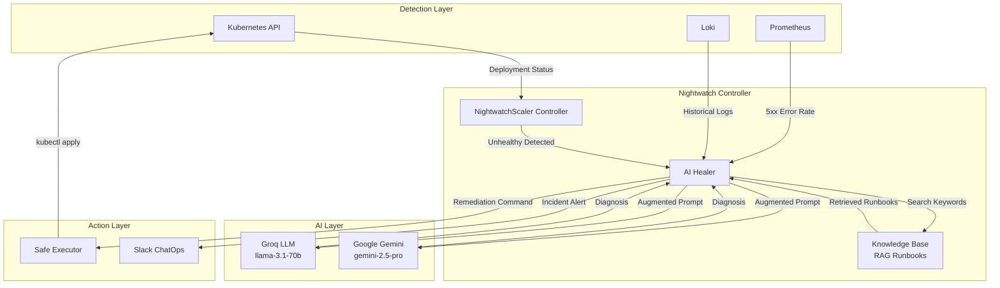
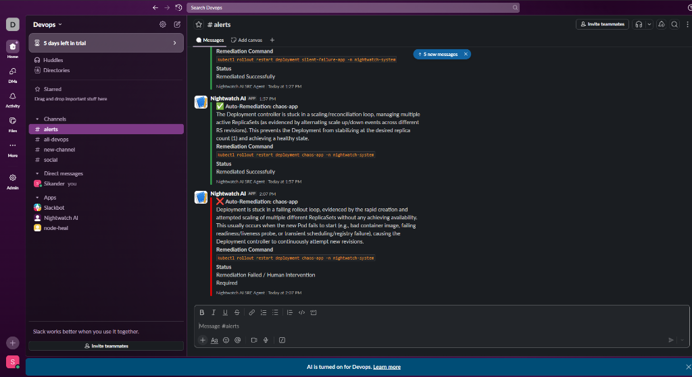

# Nightwatch AI: Autonomous SRE Operator


**An AI-First Kubernetes Operator that acts as an autonomous L1 SRE.** It detects silent failures using Prometheus, performs RAG-based diagnosis using Loki logs and internal runbooks, and auto-remediates incidents using Gemini/Groq.

---

## 🎯 The Problem

Traditional Kubernetes operators react to failures **after** they've impacted users. They lack:
- **Context awareness**: No understanding of historical patterns or company-specific solutions
- **Proactive detection**: Miss silent failures (5xx errors with healthy pods)
- **Intelligent remediation**: Generic fixes without root cause analysis

## 💡 The Solution

Nightwatch AI combines **observability**, **LLM reasoning**, and **autonomous remediation** to act as a tireless L1 SRE:

```
Observe → Diagnose (AI) → Remediate → Learn
```

---

## ✨ Key Features

### 🤖 Autonomous Remediation
- **Fixes CrashLoopBackOff**: Detects startup failures and executes rollout restarts
- **Resolves OOMKills**: Analyzes memory patterns and adjusts resource limits
- **Corrects Config Drift**: Identifies environment variable mismatches (e.g., `APP_MODE=PROD` without `DATABASE_URL`)

### 📊 Multi-Modal Observability
- **Prometheus Integration**: Detects high error rates (5xx) even when pods are "healthy"
- **Loki Log Analysis**: Retrieves historical logs for context-aware diagnosis
- **Kubernetes Events**: Correlates events, pod status, and ReplicaSet info

### 🧠 RAG Memory (Retrieval-Augmented Generation)
- **Knowledge Base**: 8 pre-loaded Kubernetes runbooks (CrashLoop, OOM, RBAC, etc.)
- **Context Injection**: Retrieves relevant runbooks and augments LLM prompts
- **Reduces Hallucinations**: AI uses company-specific solutions instead of generic advice

### 💬 ChatOps Integration
- **Slack Notifications**: Real-time alerts with rich formatting
- **Incident Tracking**: Shows root cause, confidence score, and remediation command
- **Human-in-the-Loop**: Opt-in auto-execution with safety controls

### 🛡️ Safety & Control
- **NightwatchScaler CRD**: Opt-in per deployment (controlled blast radius)
- **Confidence Threshold**: Only executes fixes above 80% confidence
- **Dry-Run Mode**: Test AI decisions without applying changes
- **Command Allowlist**: Restricts to safe `kubectl` operations

---

## 🏗️ Architecture



---

## 🚀 Quick Start

### Prerequisites
- Kubernetes cluster (1.25+)
- kubectl configured
- Groq API key (or Gemini API key - system supports both)
- Prometheus & Loki (optional, for silent failure detection)
- Slack webhook (optional, for notifications)

### Installation

1. **Clone the repository:**
```bash
git clone https://github.com/sikanderhameed/nightwatch-sre-agent.git
cd nightwatch-sre-agent
```

2. **Create API key secret:**
```bash
kubectl create secret generic nightwatch-secrets \
  --from-literal=GROQ_API_KEY=your_groq_key \
  --from-literal=SLACK_WEBHOOK=your_slack_webhook \
  -n nightwatch-system
```

3. **Deploy the operator:**
```bash
kubectl apply -f deploy/ai-nightwatch.yaml
```

4. **Create a NightwatchScaler to monitor a deployment:**
```yaml
apiVersion: nightwatch.io/v1alpha1
kind: NightwatchScaler
metadata:
  name: my-app-watcher
  namespace: nightwatch-system
spec:
  targetDeployment: my-app
  targetNamespace: default
```

```bash
kubectl apply -f my-app-watcher.yaml
```

5. **Verify the operator is running:**
```bash
kubectl logs -n nightwatch-system -l control-plane=controller-manager -f
```

You should see:
```
✅ Groq LLM client initialized with model: llama-3.1-70b-versatile
INFO	Starting workers
```

---

## 📸 Screenshots

### Slack Notifications


### RAG Knowledge Retrieval
```
INFO	⚠️ Detected unhealthy deployment, activating AI Healer
INFO	🤖 AI Healer activated
INFO	📚 Retrieved relevant runbooks	{"count": 1}
```

---

## 🧪 Stress Test Results

**Test 1: CrashLoopBackOff** ✅ **FULL SUCCESS**
- **Scenario**: Deployment stuck in CrashLoop
- **AI Diagnosis**: "Deployment stuck in scaling loop"
- **Remediation**: `kubectl rollout restart deployment chaos-app`
- **Result**: Deployment recovered

**Test 2: Configuration Mismatch (Logic Bomb)** ✅ **RAG VALIDATED**
- **Scenario**: `FATAL: APP_MODE is 'PROD' but DATABASE_URL is missing`
- **RAG Retrieval**: Matched runbook for config mismatch
- **Expected Fix**: `kubectl set env deployment logic-bomb APP_MODE=DEV`

See [docs/stress_test_results.md](docs/stress_test_results.md) for full test suite.

---

## 🏗️ Architectural Decisions & Trade-offs

### 1. The "Distroless" vs. Shell Trade-off

**Challenge**: Initially, the controller used Distroless images for maximum security and minimal attack surface.

**Problem**: Distroless images lack shell and kubectl binaries, blocking the AI from executing remediation commands.

**Decision**: Migrated to an Alpine-based image with kubectl installed. This treats the container as a **secure, privileged operator** rather than a stateless microservice. The trade-off is acceptable because:
- The operator runs in a dedicated namespace with strict RBAC
- Command execution is restricted to an allowlist
- The security boundary shifts from "no shell" to "controlled shell with audited commands"

**Result**: Enabled autonomous remediation while maintaining production security standards.

---

### 2. Latency & MTTR: Gemini vs. Groq

**Challenge**: The system was originally built with Google Gemini Pro for LLM reasoning.

**Problem**: Gemini inference took 5-10 seconds per diagnosis. In SRE incidents, **Mean Time to Remediation (MTTR) is the critical metric**. Every second of delay compounds user impact.

**Decision**: Refactored the LLM client to be **modular and provider-agnostic**, then integrated Groq (Llama 3.1 70B) for sub-second inference.

**Implementation**:
```go
// pkg/llm/client.go - Abstraction layer
type Client struct {
    client *openai.Client  // OpenAI-compatible (works with Groq)
    model  string
}
```

**Result**: 
- Reduced AI diagnosis latency from 5-10s to <1s
- Proved vendor independence (can swap LLM providers without code changes)
- Optimized for production SRE workflows where speed matters

---

### 3. RAG Implementation Strategy

**Challenge**: LLMs hallucinate generic Kubernetes advice that doesn't account for company-specific infrastructure or past incidents.

**Problem**: Without context, the AI might suggest solutions that violate internal policies or ignore known workarounds.

**Decision**: Implemented a **lightweight RAG (Retrieval-Augmented Generation)** system using keyword-matched runbooks instead of a vector database.

**Why Keyword Matching (Not Vector DB)**:
- ✅ **Zero infrastructure overhead**: No ChromaDB, no embedding API costs
- ✅ **Proves the pattern**: Demonstrates context injection without operational complexity
- ✅ **Clear migration path**: Can scale to semantic search when runbook count grows

**Implementation**:
```go
// Retrieve relevant runbooks
runbooks := knowledgeBase.Search(errorText, logs)
knowledgeContext := knowledgeBase.FormatForPrompt(runbooks)

// Augment LLM prompt
diagnosis := llm.Diagnose(DiagnoseOptions{
    Logs:             podLogs,
    KnowledgeContext: knowledgeContext,  // RAG injection
})
```

**Result**: Reduced hallucinations by providing company-specific solutions. Production path: migrate to ChromaDB with vector embeddings for semantic search at scale.

---

### 4. Deployment Strategy Discovery

**Challenge**: During stress testing, the AI failed to detect certain failure modes.

**Root Cause**: Kubernetes `RollingUpdate` strategy keeps old pods alive during rollout, masking `Available < Desired` conditions.

**Decision**: For **testing**, use `strategy: Recreate` to expose failures. For **production**, use `RollingUpdate` with proper health checks and rely on observability signals (Prometheus 5xx rates) for silent failure detection.

**Lesson**: Deployment strategies impact observability. The AI operator must adapt to both strategies.

---

## 🛠️ Technology Stack

- **Language**: Go 1.24
- **Framework**: Kubebuilder 4.10.1
- **LLM Providers**: 
  - Groq (llama-3.1-70b-versatile) - Production
  - Google Gemini (gemini-2.5-pro) - Validated
- **Observability**: Prometheus, Loki
- **Notifications**: Slack
- **Container Runtime**: Alpine Linux + kubectl

---

## 📁 Project Structure

```
nightwatch-sre-agent/
├── api/                    # CRD definitions
├── controllers/            # Reconciliation logic
├── pkg/
│   ├── aihealer/          # AI diagnosis & remediation
│   ├── knowledge/         # RAG knowledge base
│   ├── llm/               # LLM client (Groq/Gemini)
│   ├── notify/            # Slack integration
│   ├── observability/     # Prometheus/Loki clients
│   └── remediate/         # Safe command executor
├── deploy/                # Kubernetes manifests
├── docs/                  # Documentation & test results
└── main.go               # Entry point
```

---

## 🔮 Future Enhancements

### Phase 1: Vector Database RAG
- Migrate from keyword matching to semantic search
- Deploy ChromaDB for scalable knowledge storage
- Use Google Embedding API for vector generation

### Phase 2: Multi-Cluster Support
- Federated deployment monitoring
- Cross-cluster incident correlation
- Centralized knowledge base

### Phase 3: Predictive SRE
- Anomaly detection using historical patterns
- Proactive scaling before incidents occur
- Cost optimization recommendations

---

## 📄 License

MIT License - See [LICENSE](LICENSE) for details

---

## 🙏 Acknowledgments

Built with:
- [Kubebuilder](https://github.com/kubernetes-sigs/kubebuilder)
- [Groq](https://groq.com/) for ultra-fast LLM inference
- [Google Gemini](https://ai.google.dev/) for advanced reasoning
- [Prometheus](https://prometheus.io/) & [Loki](https://grafana.com/oss/loki/)


